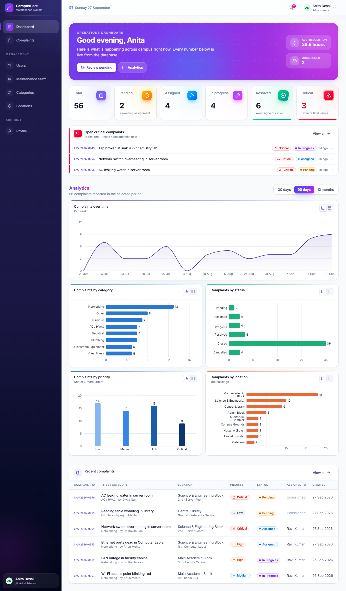
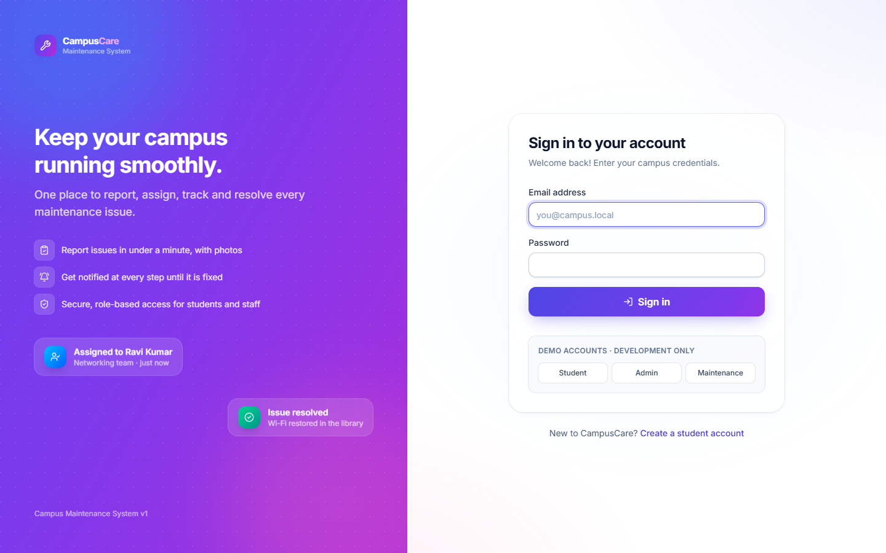
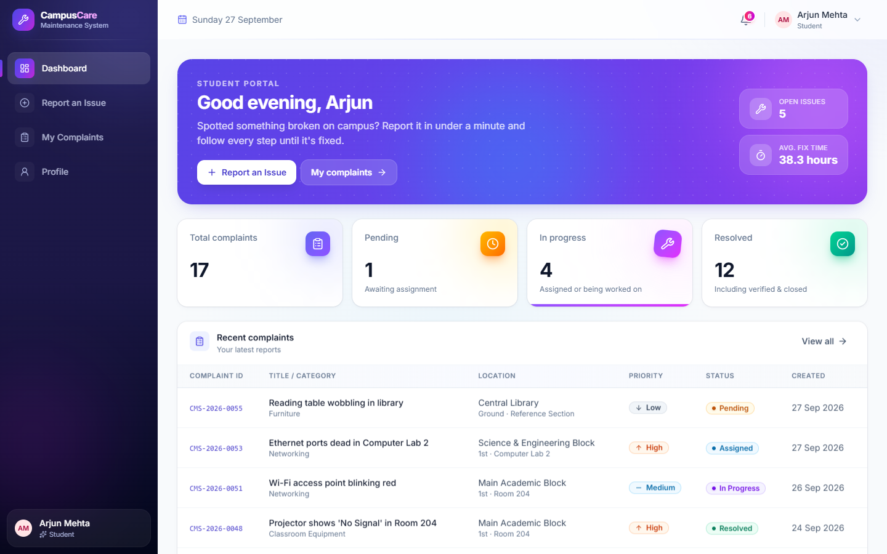
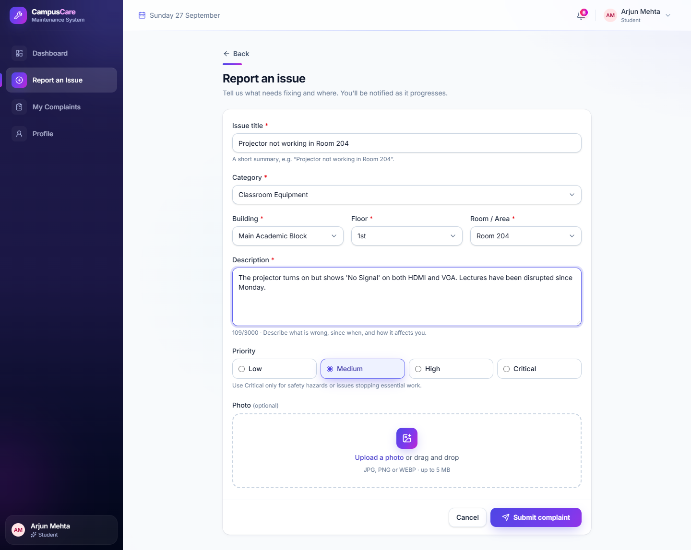
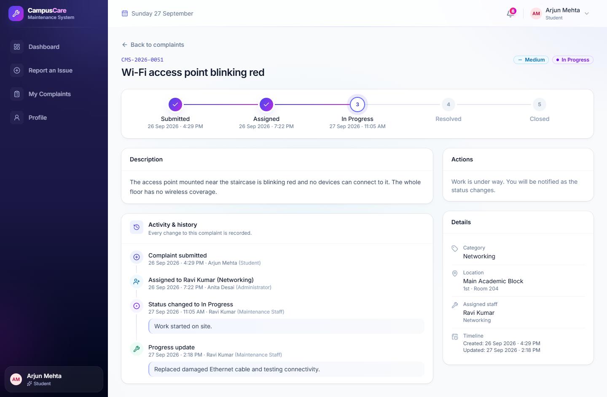
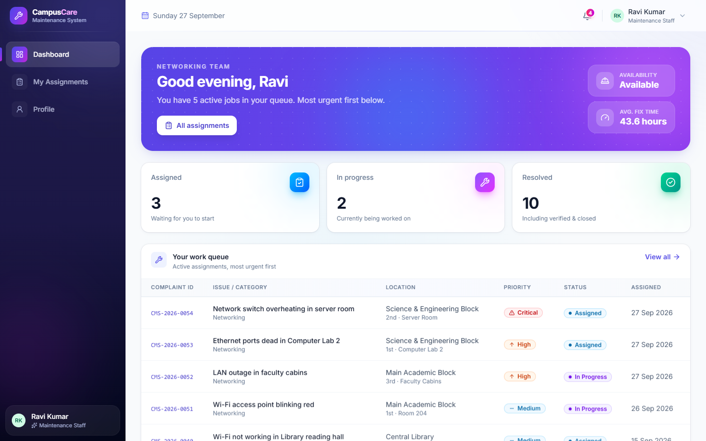
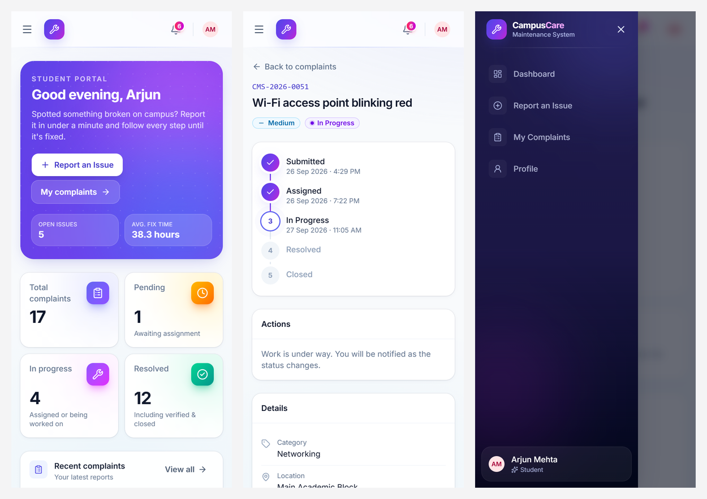

# 🏫 Campus Maintenance System — Smart Campus Operations

A full-stack campus maintenance management platform designed to streamline issue reporting, task assignment, tracking, and resolution across university campuses.

Campus Care enables students and staff to report maintenance issues such as Wi-Fi problems, electrical faults, plumbing issues, air-conditioning failures, and classroom equipment malfunctions. Administrators can prioritize complaints and assign technicians, while maintenance staff can update progress and resolve issues through a structured workflow.

## ✨ Features

### 🎓 Student Portal
- Student registration, login, and profile management
- Submit maintenance complaints with category, location, priority, and photo evidence
- Track complaint status through a visual progress timeline
- Search, filter, sort, and manage personal complaints
- Edit pending complaints and cancel requests before work starts
- View complaint history and in-app notifications

### 🛡️ Admin Portal
- Centralized operations dashboard with statistics and analytics
- Monitor complaints by category, status, priority, location, and date
- Search, filter, sort, and paginate complaint records
- Assign and reassign maintenance staff based on availability and workload
- Change complaint priority and status
- Add public or internal notes
- Verify completed work, close complaints, and reopen issues
- Manage users, maintenance staff, categories, and campus locations
- Export filtered complaint records to CSV
- Access security audit logs

### 🔧 Maintenance Technician Portal
- View assigned maintenance tasks sorted by urgency
- Start work and post progress updates
- Resolve complaints with mandatory resolution notes
- View completed-work history
- Filter tasks by status, priority, category, and location
- Update availability status
- Receive in-app notifications

### 📊 Smart Dashboard & Analytics
- Dashboard statistics and summary cards
- Interactive analytics charts
- Complaint trends over time
- Category-wise and location-wise analysis
- Priority and status distribution
- Workload tracking and maintenance performance insights

### 🎨 Modern User Interface
- Responsive desktop, tablet, and mobile layouts
- Vibrant indigo-to-fuchsia gradient design
- Dark sidebar and colourful dashboard cards
- Animated charts, progress trackers, and page transitions
- Loading states, toast notifications, and confirmation dialogs
- Keyboard-accessible controls and reduced-motion support

## 🔄 Complaint Lifecycle

Campus Care follows a structured complaint workflow:

```text
Pending → Assigned → In Progress → Resolved → Closed
   ↓          ↓
Cancelled ← Cancelled
```

- **Pending:** Complaint submitted and awaiting assignment.
- **Assigned:** A maintenance technician has been assigned.
- **In Progress:** Maintenance work has started.
- **Resolved:** The technician has completed the work.
- **Closed:** The resolution has been verified.
- **Cancelled:** The complaint has been cancelled before completion.

The backend validates status transitions, records changes in complaint history, and generates notifications for the people involved.

## 🧰 Tech Stack

| Layer | Technologies |
|---|---|
| Frontend | React 19, JavaScript, Vite |
| Styling | Tailwind CSS 4 |
| Routing | React Router |
| API Client | Axios |
| Icons | Lucide |
| Charts | Recharts |
| Backend | Python 3.12, FastAPI |
| Validation | Pydantic 2 |
| ORM | SQLAlchemy 2 |
| Database Migrations | Alembic |
| Database | PostgreSQL 16, SQLite |
| Authentication | JWT, bcrypt |
| Deployment | Docker, Docker Compose, nginx |
| Testing | pytest, Vitest, Testing Library |

## 🏗️ Architecture

```text
┌─────────────────────────────────┐
│         React Frontend          │
│                                 │
│  Student · Admin · Technician   │
│  Components · Pages · Charts    │
└────────────────┬────────────────┘
                 │
                 │ REST API / JSON
                 ▼
┌─────────────────────────────────┐
│          FastAPI Backend        │
│                                 │
│  Authentication & Authorization │
│  Complaint Workflow             │
│  Validation & Notifications      │
│  Dashboard & Analytics           │
└────────────────┬────────────────┘
                 │
                 ▼
┌─────────────────────────────────┐
│           SQLAlchemy            │
│     Models & Database Access    │
└────────────────┬────────────────┘
                 │
                 ▼
┌─────────────────────────────────┐
│       PostgreSQL / SQLite       │
│                                 │
│  Users · Complaints · History   │
│  Notifications · Audit Logs     │
└─────────────────────────────────┘
```

## 📁 Project Structure

```text
campus-care/
├── backend/
│   ├── app/
│   │   ├── main.py
│   │   ├── config.py
│   │   ├── database.py
│   │   ├── models/
│   │   ├── schemas/
│   │   ├── routers/
│   │   ├── services/
│   │   ├── dependencies/
│   │   ├── middleware/
│   │   └── utils/
│   ├── alembic/
│   ├── tests/
│   ├── seed.py
│   ├── requirements.txt
│   └── .env.example
├── frontend/
│   ├── src/
│   │   ├── api/
│   │   ├── services/
│   │   ├── context/
│   │   ├── hooks/
│   │   ├── components/
│   │   ├── layouts/
│   │   ├── pages/
│   │   ├── routes/
│   │   └── utils/
│   ├── nginx/
│   ├── package.json
│   └── .env.example
├── scripts/
├── docs/
│   └── screenshots/
├── docker-compose.yml
├── .env.example
├── README.md
└── LICENSE
```

## 🚀 Getting Started

### Prerequisites

- Python 3.11 or newer
- Node.js 20 or newer
- npm
- PostgreSQL (optional for local development)
- Docker and Docker Compose (optional)

### Quick Start

Run the following commands from the project root.

**1. Install and configure dependencies**

```bash
npm run setup
```

This sets up the Python virtual environment, installs dependencies, prepares environment files, runs database migrations, loads seed data, and installs frontend dependencies.

**2. Start the application**

```bash
npm run dev
```

**3. Open the application**

- Frontend: http://localhost:5180
- Backend API: http://localhost:8010
- API Documentation: http://localhost:8010/docs

The root-level development command starts both the frontend and backend servers.

## ⚙️ Environment Configuration

### Backend Configuration

Create `backend/.env` and configure the required settings.

```env
DATABASE_URL=sqlite:///./campus.db
SECRET_KEY=replace-with-a-secure-random-secret
ACCESS_TOKEN_EXPIRE_MINUTES=120
UPLOAD_DIR=uploads
ALLOWED_ORIGINS=http://localhost:5180
MAX_UPLOAD_SIZE=5242880
ENVIRONMENT=development
COOKIE_SECURE=false
RATE_LIMIT_ENABLED=true
TRUST_PROXY_HEADERS=false
```

For production, use a securely generated secret key, HTTPS, and appropriate database credentials.

### Frontend Configuration

Create `frontend/.env`:

```env
VITE_API_BASE_URL=/api
VITE_PROXY_TARGET=http://localhost:8010
VITE_DEV_PORT=5180
VITE_SHOW_DEMO_ACCOUNTS=true
VITE_MAX_UPLOAD_MB=5
```

Never commit real secrets or production credentials to the repository.

## 🗄️ Database Setup

The application uses Alembic to manage database schema migrations and a seed script to load development data.

```bash
cd backend
alembic upgrade head
python seed.py
```

The development seed data includes sample users, categories, campus locations, maintenance staff, complaints, complaint histories, and notifications for demonstrating dashboard functionality.

For PostgreSQL, configure `DATABASE_URL` in `backend/.env` before running migrations and seeding.

## 🐍 Run the Backend

```bash
cd backend
python -m venv .venv
```

Activate the virtual environment.

**Windows:**

```bash
.venv\Scripts\activate
```

**macOS / Linux:**

```bash
source .venv/bin/activate
```

Install the dependencies and start the API:

```bash
pip install -r requirements-dev.txt
cp .env.example .env
alembic upgrade head
python seed.py
uvicorn app.main:app --reload --port 8010
```

Backend API: http://localhost:8010

Swagger documentation: http://localhost:8010/docs

## ⚛️ Run the Frontend

```bash
cd frontend
npm install
cp .env.example .env
npm run dev
```

Frontend: http://localhost:5180

Build the production frontend:

```bash
npm run build
```

## 🐳 Docker Deployment

Docker Compose configures three services:

- PostgreSQL 16 database
- FastAPI backend
- React production frontend served through nginx

Start the services from the project root:

```bash
cp .env.example .env
```

Configure secure database credentials and a strong secret key, then run:

```bash
docker compose up --build
```

Application: http://localhost:8080

API documentation: http://localhost:8080/docs

For production deployments, disable seed data and demo-account access, enable secure cookies, and serve the application over HTTPS.

## 👤 Demo Accounts

The following development accounts are provided by the seed script.

| Role | Email | Password |
|---|---|---|
| Admin | `admin@campus.local` | `Admin@123` |
| Student | `student@campus.local` | `Student@123` |
| Maintenance | `maintenance@campus.local` | `Maintenance@123` |

**Security notice:** These credentials are intended only for local development and demonstrations. Never use them in production.

## 📚 API Documentation

FastAPI automatically generates interactive API documentation.

- Swagger UI: `/docs`
- ReDoc: `/redoc`

### Main API Modules

| Module | Functionality |
|---|---|
| Authentication | Registration, login, logout, profile, password management |
| Complaints | Create, view, update, cancel, and export complaints |
| Complaint Actions | Assignment, status updates, priority changes, notes |
| Categories | Manage complaint categories |
| Locations | Manage campus buildings and locations |
| Users & Staff | Manage user accounts and maintenance personnel |
| Notifications | View notifications and mark them as read |
| Dashboard | Statistics and analytics |
| Audit Logs | Review administrative security events |
| Health | API health checks |

## 🔐 Security

Campus Care is designed as a security-conscious full-stack project with backend-enforced controls.

- Password hashing using bcrypt
- JWT authentication with token revocation
- HTTP-only, SameSite authentication cookies
- Role-based and object-level authorization
- CSRF protection for cookie-authenticated write requests
- Backend-enforced complaint lifecycle transitions
- Input validation using Pydantic
- Image upload validation, size restrictions, and metadata removal
- Rate limiting for login, registration, and complaint creation
- Security headers and controlled CORS origins
- Parameterized database queries
- CSV formula-injection protection
- Complaint history and administrative audit logging
- Docker container hardening

## 🧪 Testing

Run the complete test suite from the project root:

```bash
npm test
```

Run backend tests:

```bash
cd backend
pytest
```

Run frontend tests:

```bash
cd frontend
npm test
```

The documented test coverage includes authentication, authorization, complaint lifecycle validation, notifications, uploads, dashboards, analytics, CSV exports, route guards, and form validation.

## 📸 Screenshots

Add screenshots to `docs/screenshots/` to showcase the application's interface.

### Admin Dashboard



### Login Page



### Student Dashboard



### Complaint Creation



### Complaint Details



### Maintenance Dashboard



### Mobile Interface



## ⚠️ Known Limitations

- Notifications are in-app only; email and push notifications are not implemented.
- Rate-limit counters are stored in process memory and would need a shared store for multi-instance deployments.
- Analytics use UTC calendar days.
- Docker deployment should be validated in the target environment before production use.

## 📄 License

This project is distributed under the MIT License. Refer to the `LICENSE` file for details.

---

**Developed by D R Seshaathri**

⭐ If you find this project useful, consider giving the repository a star!
